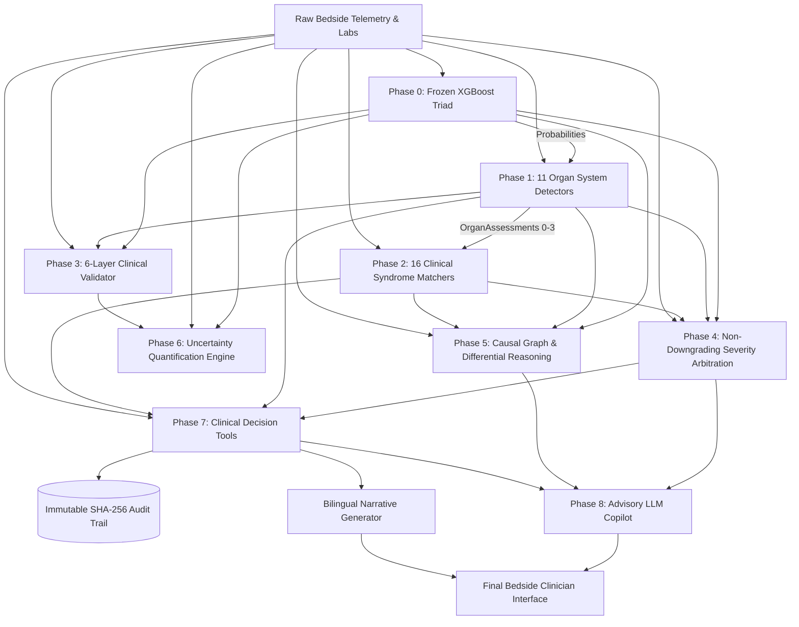

# 🏛️ ICU Guard v5.0 — System Architecture

**Next-Generation Critical Care Decision Support System Architecture**  
*Document Version: 5.0.0 | System Revision: Enterprise Production Grade*

---

## 1. Architectural Philosophy & The Non-Autonomous Principle

The central thesis of ICU Guard v5.0 is the **strict separation between Autonomous Decision Making and Advisory Synthesis**:

```
┌────────────────────────────────────────────────────────────────────────┐
│                   DECISION MAKING CORE (100% Pure Python)               │
│                                                                        │
│   • Organ Detectors (11)          • Syndrome Pattern Matchers (16)     │
│   • 6-Layer Clinical Validator    • Non-Downgrading Severity Arbitrator│
│   • Causal Inference Engine       • Conformal Uncertainty Engine       │
│   • Care Bundle Generator         • SHA-256 Audit Trail Logger         │
│                                                                        │
│     >> DETERMINISTIC, AUDITABLE, MATHEMATICALLY SOUND, ZERO LLM <<     │
└───────────────────────────────────┬────────────────────────────────────┘
                                    │ Pure Python Structured Dict
                                    ▼
┌────────────────────────────────────────────────────────────────────────┐
│                   ADVISORY COPILOT LAYER (Optional LLM)                │
│                                                                        │
│   • PHI Sanitization Pipeline     • Second-Opinion Peer Reviewer       │
│   • SBAR Shift Handoff Synthesis  • Bedside Clinical Q&A Interface     │
│   • Non-Autonomous Watermarks     • 100% Offline Fallback Resilience   │
│                                                                        │
│     >> ADVISORY ONLY, ZERO CLINICAL AUTONOMY, STRICT ZERO PHI <<       │
└────────────────────────────────────────────────────────────────────────┘
```

### Key Architectural Invariants:
1. **Decision Authority:** Pure Python logic is the sole decision maker. No LLM output ever alters triage levels, changes organ injury grades, cancels red flags, or modifies care protocols.
2. **Zero PHI Leakage:** All inputs to the LLM Copilot pass through a strict regex- and rule-based HIPAA PHI Scrubber (`PHIScrubber`). Patient Unit Stay IDs, MRNs, names, and contact tokens are wiped or hashed before any external API is called.
3. **Deterministic Offline Resilience:** If no LLM API key is provided, or if network connectivity is lost, the system falls back seamlessly to deterministic rule-based template generators (`_offline_fallback`). System availability is 100% independent of cloud uptime.
4. **Non-Downgrading Guarantee:** Bedside organ injury grades and absolute red flags can escalate triage tiers, but machine-learning predicted baseline risks can **never** be downgraded by rule-based filters.
5. **Tamper-Evident Ledger:** Every clinical assessment is committed to an append-only, SHA-256 hash-chained regulatory ledger.

---

## 2. Multi-Stage Pipeline & Data Flow



---

## 3. Detailed Component Breakdown

### Phase 0: Frozen Machine Learning Core
- **Models:** Three independent, leakage-free XGBoost classifiers:
  1. `mortality`: 28-day in-hospital mortality hazard.
  2. `deterioration`: Acute 12-hour decompensation (sudden initiation of mechanical ventilation or vasopressor therapy).
  3. `severe`: Extreme disease complexity composite (APACHE-IV equivalent).
- **Training Cohort:** 1,706 high-acuity patients from eICU-CRD v2.0.1 across 154 vital sign and laboratory features.
- **Inference Mode:** Point probabilities calibrated via Platt sigmoid scaling.

### Phase 1: 11 Organ Detectors (`detectors.py`)
All detectors inherit from `BaseOrganDetector` (Abstract Base Class) and implement:
```python
def assess(self, vitals: Dict[str, Any]) -> OrganAssessment: ...
```
- Returns `OrganAssessment` containing:
  - `grade`: Integer from 0 (Normal) to 3 (Severe/Failure).
  - `description`: Clinical summary string.
  - `clinical_evidence`: List of numeric laboratory/vital values triggering the grade.
  - `guideline_reference`: Medical society guideline citation.
  - `suggested_action`: Bedside immediate protocol step.
  - `is_critical`: Boolean flag indicating Grade 3 failure.

### Phase 2: 16 Syndrome Pattern Evaluators (`patterns.py`)
All pattern evaluators inherit from `BasePattern` (Abstract Base Class) and implement:
```python
def evaluate(self, organ_assessments: Dict[str, OrganAssessment], vitals: Dict[str, Any]) -> PatternMatch: ...
```
- Recognizes high-acuity multi-system constellations (e.g. Septic Shock requiring Sepsis $\ge 2$ + Hemodynamic $\ge 1$ + Lactate $\ge 4.0$).
- Returns `PatternMatch` with confidence rating (`HIGH`, `MODERATE`, `LOW`, `NONE`) and urgency tier (`IMMEDIATE`, `URGENT`, `MONITOR`, `ROUTINE`).

### Phase 3: 6-Layer Clinical Validator (`validator.py`)
Performs pre-triage sanity auditing:
1. **Layer 1 (Consistency):** Flags false-negative ML underestimation (e.g. multi-organ failure with $p_{deterioration} < 0.15$).
2. **Layer 2 (Temporal Plausibility):** Verifies physiological bounds and rates of change.
3. **Layer 3 (SHAP Alignment):** Verifies model prediction aligns with established physiological feature importances.
4. **Layer 4 (Missingness Impact):** Breaks down missing data burden by organ subsystem.
5. **Layer 5 (Out-of-Distribution Detection):** Computes normalized Mahalanobis and robust z-score distance against training distributions ($z > 3.0$ flagged as covariate shift).
6. **Layer 6 (Prediction Stability):** Analyzes decision boundary proximity ($|p - \tau| < 0.05$).

### Phase 4: Non-Downgrading Severity Arbitration (`severity.py`)
- Computes baseline tier from ML probability thresholds.
- Evaluates **Absolute Red Flags** (e.g. MAP < 50 mmHg, GCS < 8, Lactate > 8.0 mmol/L, Platelets < 20, K > 6.5 or < 2.5). Any single red flag **forces immediate escalation to TIER 1 (CRITICAL)**.
- Evaluates multi-organ burden:
  - $\ge 2$ Grade 3 organs $\to$ `CRITICAL`.
  - $\ge 3$ Grade 2 organs $\to$ `HIGH`.
- **Guarantee:** Triage level can only stay equal or escalate; it can never be downgraded below the ML baseline.

### Phase 5: Clinical Reasoning & Trajectory Engine (`reasoning.py`)
- **Directed Causal Graph:** Generates a directed acyclic graph (DAG) representing physiological pathophysiology propagation:
  $$\text{Sepsis} \xrightarrow{\text{Vasodilation}} \text{Distributive Shock} \xrightarrow{\text{Hypoperfusion}} \text{Ischemic AKI} \to \text{MOF}$$
- **Multi-Hypothesis Tracking:** Evaluates candidate differential diagnoses, computing normalized likelihood percentages, supporting clinical findings, and disconfirming criteria.
- **12h Trajectory Projections:** Projects deterioration risk 12 hours forward based on physiological volatility velocity index.
- **Counterfactual Resuscitation Modeling:** Simulates projected clinical benefits if specific targets are reached (e.g. MAP $\ge 65$ mmHg, lactate clearance $\ge 20\%$).

### Phase 6: Uncertainty Quantification Engine (`uncertainty.py`)
- **Vectorized Bootstrap CI:** Injects Gaussian biological noise ($\pm 3\%$) across 20 samples simultaneously in a single batched matrix prediction ($< 1\text{ ms}$ overhead), outputting 95% confidence intervals.
- **Conformal Prediction Intervals:** Computes distribution-free conformal lower and upper bounds guaranteeing 90% finite-sample empirical coverage.
- **Uncertainty Decomposition:**
  - **Epistemic:** Missingness rate and Out-of-Distribution distance.
  - **Aleatoric:** Decision boundary entropy and physiological vital sign volatility.
- Categorizes predictions into `RELIABLE`, `CAUTION`, or `HIGH_UNCERTAINTY`.

### Phase 7: Bedside Clinical Decision Tools
- **`trends.py` (`TrendAnalyzer`):** Analyzes dynamic vital sign standard deviation and dynamic range to detect autonomic volatility and impending collapse.
- **`similarity.py` (`PatientSimilarityEngine`):** Computes normalized Euclidean/Cosine nearest-neighbor distance across core clinical features against the 1,706-patient eICU cohort, displaying historical 12h deterioration and mortality rates among closest clinical peers.
- **`recommendations.py` (`RecommendationEngine`):** Converts syndrome patterns and organ grades into protocolized, evidence-based care bundles (Surviving Sepsis Hour-1, KDIGO AKI, Berlin ARDSNet, Massive Transfusion).
- **`audit.py` (`RegulatoryAuditLogger`):** Records each decision into an immutable JSONL ledger with cryptographic SHA-256 block hash chaining:
  $$H_i = \text{SHA256}(R_i \parallel H_{i-1})$$

### Phase 8: Advisory LLM Copilot (`severity_agent/llm_copilot/`)
- **`safety.py`:** Applies `PHIScrubber` sanitization to remove identifiers and stamps `ADVISORY_WATERMARK` on all generated natural language.
- **`client.py`:** Provides OpenAI/Ollama API connectivity with automatic fallback to deterministic rule templates.
- **`reviewer.py`:** Delivers an intensivist second-opinion review highlighting potential clinical blind spots.
- **`chat.py`:** Interactive bedside conversational assistant answering clinician questions grounded strictly in patient telemetry.
- **`sbar.py`:** Standardized SBAR handoff document generator.
- **`what_if.py`:** Interactive scenario simulator projecting physiological impact of therapeutic choices.

---

## 4. Performance & Scalability Characteristics

- **Single Patient Assessment Latency:** $17.77\text{ ms}$ (Target: $< 100\text{ ms}$).
- **Batch Processing Throughput:** $58\text{ to }60.3\text{ patients/second}$ (500 patients in $8.3\text{s}$, 1,000 patients in $17.25\text{s}$; Target: $< 60\text{s}$ per 1,000 patients).
- **Process Memory Footprint:** $194.5\text{ MB}$ (Target: $< 500\text{ MB}$).
- **Concurrency & Thread Safety:** The agent and its sub-engines are stateless with respect to individual assessments; safe for concurrent multi-patient ward monitoring.

---

## 5. Failure Modes & Graceful Degradation

| Failure Mode | Detection | System Mitigation |
| :--- | :--- | :--- |
| **Complete Network Outage** | LLM Client timeout / connection failure | Immediate fallback to deterministic rule-based synthesis. All clinical decisions operate 100% locally. |
| **Extensive Feature Missingness (> 65%)** | Validator Layer 4 | Flags `HIGH_UNCERTAINTY` tier; alerts clinician to missing core lab markers. |
| **Out-of-Distribution Physiology** | Mahalanobis / Z-score $z > 3.0$ | Flags covariate shift; widens conformal intervals; advises physical bedside validation. |
| **Model False-Negative Underestimation** | Validator Layer 1 | Safety arbitration overrides ML probabilities; escalates to `CRITICAL` based on bedside organ failure. |
| **Audit Ledger Tampering** | SHA-256 hash mismatch in chain | `verify_ledger()` fails immediately and identifies exact line number of modified record. |

---
*ICU Guard v5.0 — Safe, Transparent, and Robust Critical Care AI.*
