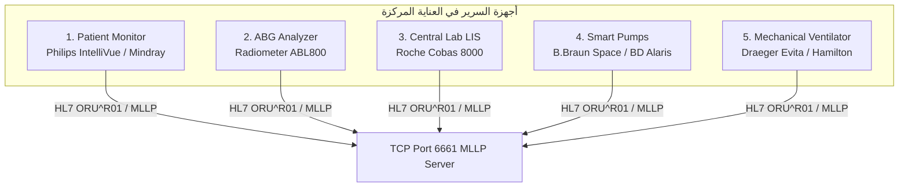
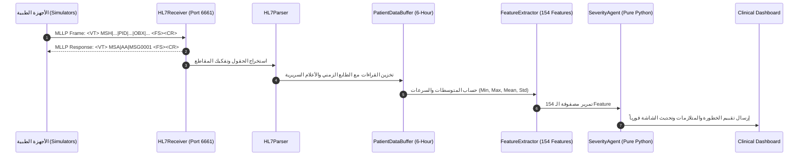

# 📘 ICU Guard v5.0 — الدليل التوثيقي الشامل للمشروع (Master System Documentation)

**نظام دعم القرار السريري الذكي ومحاكي أجهزة العناية المركزة بالبروتوكول الطبي الموحد (HL7 v2.5)**  
*نسخة النظام: 5.0.0 Enterprise | التوثيق الهندسي والطبي الكامل*

---

## 📑 فهرس المحتويات (Table of Contents)
1. [نظرة عامة والهدف من المشروع (Executive Summary & Clinical Need)](#1-نظرة-عامة-والهدف-من-المشروع)
2. [المعمارية العامة ومبدأ الفصل الصارم (System Architecture & The Non-Autonomous Principle)](#2-المعمارية-العامة-ومبدأ-الفصل-الصارم)
3. [نواة الذكاء الاصطناعي وتجهيز البيانات (Machine Learning Core & Cohort Engineering)](#3-نواة-الذكاء-الاصطناعي-وتجهيز-البيانات)
4. [محرك الاستدلال السريري وتقييم الخطورة (Severity Agent & Clinical Reasoning Engine)](#4-محرك-الاستدلال-السريري-وتقييم-الخطورة)
5. [محاكي أجهزة العناية المركزة الطبية (HL7 Medical Device Simulator)](#5-محاكي-أجهزة-العناية-المركزة-الطبية)
6. [طبقة الربط والاستقبال اللحظي (Integration Layer & Telemetry Ingestion)](#6-طبقة-الربط-والاستقبال-اللحظي)
7. [لوحة التحكم السريرية التفاعلية (Clinical Interactive Dashboard)](#7-لوحة-التحكم-السريرية-التفاعلية)
8. [المساعد السريري الاستشاري المتقدم (LLM Clinical Copilot & Safety Layer)](#8-المساعد-السريري-الاستشاري-المتقدم)
9. [الأمان والامتثال والتدقيق المشفر (Audit Ledger & Regulatory Compliance)](#9-الأمان-والامتثال-والتدقيق-المشفر)
10. [دليل التشغيل والاختبار (Operations, Testing & CLI Guide)](#10-دليل-التشغيل-والاختبار)

---

## 1. نظرة عامة والهدف من المشروع
### 1.1 المشكلة السريرية (The Clinical Problem)
في وحدات العناية المركزة (ICU)، يواجه الأطباء والتمريض تحديات معقدة:
* **تشتت البيانات (Data Fragmentation):** المريض متصل بعدة أجهزة مستقلة (شاشة المراقبة، مضخات المحاليل، جهاز التنفس الصناعي، غازات الدم، نتائج المعمل المركزي). كل جهاز يعمل بنظام منعزل.
* **إجهاد الإنذارات (Alarm Fatigue):** تصدر مئات الإنذارات الصوتية يومياً، أكثر من 85% منها غير ذي مغزى سريري، مما يؤدي لتأخر الاستجابة للتدهور الحقيقي.
* **التدهور الصامت (Silent Decompensation):** تدهور المريض (مثل الصدمة الإنتانية أو متلازمة الضائقة التنفسية الحادة) يبدأ قبل الانهيار الصريح بـ 6 إلى 12 ساعة على مستوى تغيرات طفيفة متعددة الأعضاء.

### 1.2 حل ICU Guard v5.0
نظام متكامل يجمع بين:
1. **محاكاة أجهزة العناية المركزة المصرية والعالمية** وإرسال بياناتها ببروتوكول **HL7 v2.5 عبر MLLP TCP**.
2. **استقبال وهضم البيانات لحظياً (Streaming Ingestion)** عبر طبقة ربط سريعة وتجميعها في نافذة انزلاقية مدتها 6 ساعات.
3. **التنبؤ بالتدهور عبر Machine Learning** تم تدريبه على 1,706 مريض عالي الخطورة من قاعدة بيانات eICU-CRD باستخدام 154 مؤشراً سريرياً.
4. **محرك استدلال سريري حتمي (100% Deterministic Pure Python)** يحلل 11 جهازاً عضوياً و16 متلازمة مرضية وفقاً لأحدث الإرشادات الطبية العالمية (Surviving Sepsis, Berlin ARDS, KDIGO AKI).
5. **لوحة تحكم فائقة الدقة (High-Fidelity Dashboard)** توفر مراقبة حية للمريض، إنذارات ذكية، تحليلاً سببياً، وتوليد تقارير SBAR باللغتين العربية والإنجليزية.

---

## 2. المعمارية العامة ومبدأ الفصل الصارم

### 2.1 مبدأ عدم الاستقلالية السريرية (The Non-Autonomous Principle)
يفصل النظام فصلاً قاطعاً ومستحيلاً تجاوزه بين:
* **نواة اتخاذ القرار (Decision Making Core):** تعمل بـ **Pure Python حتمي 100%**. هي الوحيدة المسؤولة عن تحديد درجات خطورة الأعضاء، تصنيف الترياج (Triage Tier)، تفعيل بروتوكولات العلاج الفوري، والتحقق من سلامة الأرقام. **لا يتدخل أي نموذج لغوي (LLM) في اتخاذ القرار الطبي.**
* **طبقة المساعد الاستشاري (Advisory Copilot Layer):** نموذج لغوي (LLM) استشاري فقط. وظيفته تلخيص الحالة بصيغة SBAR، المساعدة في الإجابة على استفسارات الفريق الطبي، واقتراح سيناريوهات افتراضية ("What-If"). جميع مخرجاته موسومة بختم استشاري غير ملزم ويسبقها نزع كامل لأي بيانات تعريفية للمريض (Zero PHI).

```
┌────────────────────────────────────────────────────────────────────────┐
│                   DECISION MAKING CORE (100% Pure Python)               │
│                                                                        │
│   • Organ Detectors (11)          • Syndrome Pattern Matchers (16)     │
│   • 6-Layer Clinical Validator    • Non-Downgrading Severity Arbitrator│
│   • Causal Inference Engine       • Conformal Uncertainty Engine       │
│   • Care Bundle Generator         • SHA-256 Audit Trail Logger         │
│                                                                        │
│     >> DETERMINISTIC, AUDITABLE, MATHEMATICALLY SOUND, ZERO LLM <<     │
└───────────────────────────────────┬────────────────────────────────────┘
                                    │ Pure Python Structured Dict
                                    ▼
┌────────────────────────────────────────────────────────────────────────┐
│                   ADVISORY COPILOT LAYER (Optional LLM)                │
│                                                                        │
│   • PHI Sanitization Pipeline     • Second-Opinion Peer Reviewer       │
│   • SBAR Shift Handoff Synthesis  • Bedside Clinical Q&A Interface     │
│   • Non-Autonomous Watermarks     • 100% Offline Fallback Resilience   │
│                                                                        │
│     >> ADVISORY ONLY, ZERO CLINICAL AUTONOMY, STRICT ZERO PHI <<       │
└────────────────────────────────────────────────────────────────────────┘
```

---

## 3. نواة الذكاء الاصطناعي وتجهيز البيانات

### 3.1 مجتمع الدراسة (Cohort Engineering)
* **المصدر:** قاعدة بيانات eICU Collaborative Research Database v2.0.1.
* **الحجم:** 1,706 إقامة عناية مركزة عالية الخطورة لم تتكرر بها البيانات وتمت تصفيتها بدقة.
* **الهدف:** التنبؤ بثلاثة مخرجات سريرية مستقلة في وقت واحد (Multi-Label Classification):
  1. `mortality`: خطر الوفاة داخل المستشفى (28-day in-hospital mortality).
  2. `deterioration`: التدهور الحاد خلال 12 ساعة القادمة (الحاجة لبدء التنفس الصناعي الإجباري أو مقويات الأوعية الدموية).
  3. `severe`: الحالة السريرية المعقدة والحرجة الموازية لمعايير APACHE-IV.

### 3.2 هندسة المؤشرات (154 Features)
يتم حساب المؤشرات من 21 متغيراً حيوياً ومعملياً خلال نافذة المراقبة (6 ساعات):
* **المؤشرات الحيوية السريرية (32 مؤشراً):**
  - Heart Rate, Systolic BP, Diastolic BP, MAP, Respiratory Rate, SaO2, Temperature.
  - لكل متغير: `min`, `max`, `mean`, `std`.
* **مؤشرات غازات الدم والتحاليل المعملية (108 مؤشراً):**
  - pH, PaO2, PaCO2, Lactate, Creatinine, BUN, WBC, Platelets, Hemoglobin, Glucose, K+, Na+, Bilirubin, Albumin, AST, ALT.
  - لكل تحليل: `min`, `max`, `mean`, ومؤشر الغياب `_missing`.
* **المشتقات الفسيولوجية والديناميكية (14 مؤشراً):**
  - Shock Index ($HR / SBP$), Pulse Pressure ($SBP - DBP$), Oxygen Reserve ($SaO2 \times PaO2 / 100$).
  - معدلات التغير اللحظية (Velocity / Trend vectors).
  - الخصائص الديموغرافية: العمر، الجنس، نقاط APACHE IV عند الدخول.

### 3.3 النماذج الرياضية والمعايرة
* **الخوارزمية:** ثلاثي نماذج XGBoost معززة مستقلة تم ضبط معاملاتها الفائقة عبر Optuna.
* **معايرة الاحتمالات (Probability Calibration):** استخدام طريقة Platt Sigmoid Scaling لضمان أن الاحتمال $P=0.80$ يعني واقعياً أن 80 مريضاً من كل 100 سيتعرضون للحدث.
* **فترات الثقة المطابقة (Conformal Prediction):** حساب حدود الثقة بنسبة 80% و90% و95% (Coverage Guarantees) بحيث يعلم الطبيب درجة عدم اليقين المعرفي (Epistemic Uncertainty) للنموذج.

---

## 4. محرك الاستدلال السريري وتقييم الخطورة (`severity_agent/`)

### 4.1 كواشف الأجهزة العضوية الـ 11 (`detectors.py`)
يقوم كل كاشف بفحص قراءات المريض وتقييم الضرر من **الدرجة 0 (سليم)** إلى **الدرجة 3 (فشل عضوي حاد)** استناداً لأدلة سريرية دولية:

| الكاشف العضوي | المرجع الطبي المعتمد | أهم العتبات للدرجة 3 (فشل حاد) |
|---|---|---|
| **1. التنفسي (Respiratory)** | Berlin ARDS Definition 2012 | $SaO2 < 85\%$ أو $PaO2 < 50\text{ mmHg}$ أو $RR \ge 35$ |
| **2. الديناميكا الدموية (Hemodynamic)** | Surviving Sepsis Campaign 2021 | $MAP < 50\text{ mmHg}$ أو $SBP < 70\text{ mmHg}$ أو Shock Index $> 1.3$ |
| **3. الكلوي (Renal)** | KDIGO AKI Guidelines 2012 | Creatinine $> 3.5\text{ mg/dL}$ أو زيادة بمقدار $\ge 3\times$ |
| **4. العصبي (Neurological)** | Glasgow Coma Scale (GCS) | $GCS \le 8$ (فقدان منعكسات حماية مجرى الهواء) |
| **5. الإنتان (Sepsis)** | Sepsis-3 Consensus / SOFA | استيفاء معايير SIRS + ارتفاع اللاكتات $> 4.0\text{ mmol/L}$ |
| **6. الكبدي (Hepatic)** | Child-Pugh / SOFA Score | Bilirubin $> 6.0\text{ mg/dL}$ مع ارتفاع إنزيمات الكبد |
| **7. التجلط (Coagulation)** | ISTH Overt DIC Algorithm | Platelets $< 50\text{ K/\mu L}$ مع تدهور مؤشرات التجلط |
| **8. الأيضي (Metabolic)** | Stewart Acid-Base Approach | $pH < 7.15$ أو $pH > 7.60$ أو Lactate $> 5.0\text{ mmol/L}$ |
| **9. الغدد والسكري (Endocrine)** | ADA Inpatient Standards 2024 | Glucose $< 50\text{ mg/dL}$ أو Glucose $> 400\text{ mg/dL}$ |
| **10. الدموي (Hematologic)** | AABB Transfusion Guidelines | Hemoglobin $< 7.0\text{ g/dL}$ (مؤشر نقل دم إسعافي) |
| **11. التغذوي (Nutritional)** | ESPEN ICU Nutrition Guidelines | نقص شديد في الألبومين والكهارل الحيوية |

### 4.2 مطابقة المتلازمات السريرية الـ 16 (`patterns.py`)
يكتشف النظام المتلازمات المعقدة الناتجة عن تداخل إصابة عدة أعضاء معاً:
1. **Septic Shock:** هبوط ضغط حاد + بؤرة إنتان + لاكتات مرتفع.
2. **ARDS:** نقص أكسجة حاد + تسرع تنفسي مع مؤشرات ارتشاح رئوي.
3. **Acute Kidney Injury (AKI):** قفزة في الكرياتينين واليوريا مع تراجع الإخراج البولي.
4. **Multi-Organ Failure (MOF):** فشل متزامن في 3 أعضاء حيوية أو أكثر.
5. **Neuro-Respiratory Failure:** انخفاض GCS مع ضعف الجهد التنفسي.
6. **Cardiogenic Shock:** انخفاض ضغط مع علامات احتقان وفشل مضخة القلب.
7. **Hemorrhagic Shock:** انخفاض الهيموجلوبين مع تسرع القلب وهبوط الضغط.
8. **Disseminated Intravascular Coagulation (DIC):** نقص صفائح حاد مع اعتلال تخثر جهازي.
9. **ICU Delirium:** تذبذب الحالة العقلية مع علامات خلل عصبي حاد.
10. **Refractory Vasodilatory Shock:** صدمة غير مستجيبة لمضادات التقلص الوعائي.
11. **Type 1 Respiratory Failure:** فشل تنفسي نقص أكسجة ($PaO2 < 60$).
12. **Type 2 Respiratory Failure:** فشل تنفسي احتباس ثاني أكسيد الكربون ($PaCO2 > 50$).
13. **Hepatorenal Syndrome:** قصور كلوي متقدم ناتج عن فشل كبدي حاد.
14. **Postoperative Deterioration:** تدهور مفاجئ في العلامات الحيوية بعد العمليات.
15. **Severe Acidemia:** حموضة دموية حرجة تهدد بانهيار عضلة القلب ($pH < 7.10$).
16. **Hyperosmolar / DKA Crisis:** اضطراب سكري حاد مع اختلال كهرلي شديد.

### 4.3 محكم الخطورة غير التنازلي (`severity.py`)
يصنف المريض إلى 4 مستويات سريرية:
* **TIER 1 — CRITICAL (أحمر):** تهديد مباشر وفوري للحياة.
* **TIER 2 — HIGH RISK (برتقالي):** تدهور متسارع يستلزم تدخلاً عاجلاً.
* **TIER 3 — MODERATE (أصفر):** حالة غير مستقرة تحتاج لمراقبة لصيقة.
* **TIER 4 — STABLE (أخضر):** استقرار نسبي في الوظائف الحيوية.

**قاعدة الأمان الذهبية (Non-Downgrading Invariant):**
إذا تنبأ نموذج الـ ML أو كواشف الأعضاء بدرجة خطورة عالية، **لا يمكن لأي فلتر أو منطق برمجي أن يخفض درجة الخطورة**. الخطورة ترتفع فقط في وجود علامات الخطر المطلقة (Absolute Red Flags) مثل:
* $MAP < 50\text{ mmHg}$
* $SaO2 < 50\%$
* $Lactate > 8.0\text{ mmol/L}$
* $pH < 7.10$
* $GCS < 8$

### 4.4 المحقق السريري سداسي الطبقات (`validator.py`)
يقوم بـ 6 فحوصات تحقق قبل قبول أي قراءة:
1. **Physical Range Bounds:** استبعاد المستحيلات الفيزيائية (مثل ضغط سالب).
2. **Physiological Plausibility:** التأكد من إمكانية بقاء الإنسان حياً بهذه الأرقام.
3. **Temporal Velocity Plausibility:** استبعاد الطفرات اللحظية الناتجة عن انفصال سلك الحساس (مثل قفزة القلب من 70 إلى 220 خلال ثانية).
4. **Cross-Variable Consistency:** فحص التوافق الفسيولوجي (مثل استحالة وجود ضغط نبضي $SBP - DBP \le 0$).
5. **Out-of-Distribution (OOD):** رصد الحالات الخارجة إحصائياً عن نطاق تدريب النموذج.
6. **Missingness Thresholding:** التحقق من وجود حد أدنى كافٍ من البيانات لإصدار قرار طبي.

---

## 5. محاكي أجهزة العناية المركزة الطبية (`hl7_simulator/`)

يحاكي النظام بيئة العناية المركزة المصرية والعالمية بدقة متناهية عبر 5 أجهزة رئيسية تبث رسائل **HL7 v2.5 ORU^R01** عبر بروتوكول **MLLP TCP على Port 6661**:



### 5.1 تفاصيل الأجهزة المحاكاة ومكتبة أكواد LOINC

#### 1. شاشة مراقبة المريض بجانب السرير (Bedside Patient Monitor)
* **الماركات المدعومة:** Philips IntelliVue MX800, GE CARESCAPE B850, Mindray BeneVision N22.
* **المؤشرات المرسلة دورياً (كل 30-60 ثانية):**
  - Heart Rate (`8867-4`, bpm)
  - Systolic Blood Pressure (`8480-6`, mmHg)
  - Diastolic Blood Pressure (`8462-4`, mmHg)
  - Mean Arterial Pressure (`8478-0`, mmHg)
  - Respiratory Rate (`9279-1`, breaths/min)
  - Arterial Oxygen Saturation SpO2 (`59408-5`, %)
  - Core Body Temperature (`8310-5`, °C)

#### 2. جهاز تحليل غازات الدم الشرياني (Arterial Blood Gas - ABG Analyzer)
* **الماركات المدعومة:** Radiometer ABL800 Flex, Roche Cobas b 123, Instrumentation Laboratory GEM Premier.
* **المؤشرات الحيوية:**
  - Arterial Blood pH (`2744-1`, pH units)
  - Arterial Oxygen Tension PaO2 (`2703-7`, mmHg)
  - Arterial Carbon Dioxide Tension PaCO2 (`2019-8`, mmHg)
  - Blood Lactate Concentration (`2524-7`, mmol/L)
  - Base Excess (`11555-0`, mmol/L) & Bicarbonate HCO3 (`1963-8`, mmol/L)

#### 3. المعمل المركزي (Central Laboratory Information System - LIS)
* **الماركات المدعومة:** Roche Cobas 8000, Abbott Architect, Siemens Atellica.
* **المؤشرات الكيميائية والدموية (10 تحاليل أساسية):**
  - Serum Creatinine (`2160-0`, mg/dL)
  - Blood Urea Nitrogen BUN (`3094-0`, mg/dL)
  - White Blood Cells WBC (`6690-2`, K/µL)
  - Platelet Count (`777-3`, K/µL)
  - Hemoglobin (`718-7`, g/dL)
  - Blood Glucose (`2345-7`, mg/dL)
  - Serum Potassium K+ (`2823-3`, mmol/L)
  - Serum Sodium Na+ (`2951-2`, mmol/L)
  - Total Bilirubin (`1975-2`, mg/dL)
  - Serum Albumin (`1751-7`, g/dL)

#### 4. مضخات المحاليل والأدوية الذكية (Smart Infusion Pumps)
* **الماركات المدعومة:** B.Braun Space, BD Alaris System, Fresenius Kabi Agilia.
* **الأدوية ومعدلات الحقن:**
  - Norepinephrine (`Noradrenaline_Rate`, mcg/kg/min)
  - Epinephrine (`Epinephrine_Rate`, mcg/kg/min)
  - Dopamine (`Dopamine_Rate`, mcg/kg/min)
  - Propofol (`Propofol_Rate`, mcg/kg/min)
  - Fentanyl (`Fentanyl_Rate`, mcg/hr)

#### 5. جهاز التنفس الصناعي الميكانيكي (Mechanical Ventilator)
* **الماركات المدعومة:** Draeger Evita V800, Hamilton Medical G5, Puritan Bennett 980.
* **معايير التنفس الصناعي:**
  - Fraction of Inspired Oxygen FiO2 (`19994-3`, %)
  - Positive End-Expiratory Pressure PEEP (`76530-5`, cmH2O)
  - Tidal Volume (`76531-3`, mL)
  - Peak Inspiratory Pressure PIP (`76532-1`, cmH2O)
  - Plateau Pressure (`76533-9`, cmH2O)
  - Minute Ventilation (`76534-7`, L/min)

### 5.2 مكتبة السيناريوهات السريرية المتخصصة (`scenarios/`)
تضم أكثر من 15 سيناريو سريري يحاكي ديناميكيات المرضى الحقيقية:
* `StableScenario`: مريض مستقر تتقلب قراءاته ضمن النطاق الفسيولوجي الطبيعي.
* `DeterioratingSepticScenario`: تدهور تدريجي في الضغط مع ارتفاع ضربات القلب واللاكتات.
* `CriticalARDSScenario`: هبوط حاد في الأكسجة يستدعي رفع PEEP و FiO2.
* `RenalFailureScenario`: ارتفاع مستمر في الكرياتينين واليوريا مع احتباس البوتاسيوم.
* `DICScenario`: هبوط سريع في الصفائح مع نزيف واعتلال تخثر.
* `CardiogenicShockScenario`: فشل في النتاج القلبي مع انخفاض الضغط النبضي.

---

## 6. طبقة الربط والاستقبال اللحظي (`severity_agent/hl7/`)



* **HL7Receiver (`receiver.py`):** سيرفر TCP غير متزامن يستقبل حزم MLLP، يفك التأطير (`\x0b` في البداية و `\x1c\x0d` في النهاية)، ويرد فوراً بـ `ACK` لتفادي timeout الأجهزة.
* **HL7Parser (`parser.py`):** يفكك مقاطع `MSH` (رأس الرسالة والجهة المرسلة)، `PID` (بيانات المريض والسرير)، `OBR` (نوع الفحص)، و `OBX` (القراءات الفسيولوجية والوحدات وأعلام الخطر `LL`, `L`, `N`, `H`, `HH`).
* **PatientDataBuffer (`buffer.py`):** ذاكرة انزلاقية مؤقتة تخزن قراءات آخر 6 ساعات لكل مريض وتلغي القديم تلقائياً.
* **HL7FeatureExtractor (`feature_extractor.py`):** يحول القراءات المخزنة مباشرة إلى متجه الـ 154 Feature المطلوب لتغذية نموذج الـ ML.
* **DeviceManager (`device_manager.py`):** يراقب حالة الاتصال لكل جهاز، عدد الرسائل المستلمة، معدل النبض (Heartbeat)، ويبلغ عن أي انقطاع.

---

## 7. لوحة التحكم السريرية التفاعلية (`dashboard/`)

تم بناء واجهة المستخدم باستخدام **NiceGUI** المعتمدة على Python و Vue 3 و Tailwind CSS مع ثيم طبي مظلم عالي التباين (Ultra-Crisp Clinical Dark Mode) مصمم لبيئات العناية المركزة لتقليل إجهاد العين.

### 7.1 صفحات النظام
1. **سجل المرضى وغرفة التحكم (`/patient_selection`):**
   - عرض قائمة المرضى المصنفة حسب ترياج الخطورة (Critical, High, Moderate, Stable).
   - إحصائيات سريعة عن عدد الأسرة المشغولة، متوسط APACHE IV، والحالات الحرجة.
   - فلترة وبحث سريع برقم السرير أو المعرف الطبي.
2. **شاشة المراقبة السريرية الحية (`/live_monitor`):**
   - بث مباشر للعلامات الحيوية الـ 6 الأساسية مع مخططات Sparklines تعرض آخر 20 نقطة زمنية.
   - كشف لحظي عن المتلازمات النشطة مع شريط زمني تفاعلي يسجل كافة الأحداث السريرية.
   - نظام إنذار صوتي ومرئي فوري عند اختراق العتبات الحرجة.
   - أزرار تحكم في سرعة المحاكاة ($1\times, 5\times, 10\times, 50\times$) مع إمكانية الإيقاف المؤقت والاستئناف.
3. **تقرير التقييم السريري النهائي (`/final_assessment`):**
   - تفكيك شامل لإصابات الأعضاء الـ 11 عبر بطاقات ورادارات تفاعلية.
   - استعراض متلازمات الأمراض النشطة وحزم العلاج المقترحة (Hour-1 Sepsis Bundle, KDIGO AKI).
   - مخطط السبب والنتيجة (Causal Directed Acyclic Graph - DAG) يوضح تسلسل حدوث التدهور.
   - تصدير تقرير طبي رسمي بصيغة PDF معد للطباعة والأرشفة.
4. **بوابة بث HL7 وتحليل الأجهزة (`/hl7_stream`):**
   - استعراض حي للحزم الواردة عبر MLLP Port 6661 بصيغتيها (Raw HL7 و Formatted Trees).
   - تلوين المقاطع حسب درجة الخطر.
   - فلترة حسب نوع الجهاز (Monitor, ABG, Lab, Pumps, Ventilator).
   - حقن حزم تجريبية وتصدير البيانات بتنسيقات (JSON, CSV, HL7).

---

## 8. المساعد السريري الاستشاري المتقدم (`llm_copilot/`)

### 8.1 حماية البيانات الصحية (HIPAA Zero-PHI Pipeline)
قبل إرسال أي نص سريري إلى النموذج اللغوي، يمر عبر `PHIScrubber`:
* حجب أرقام السجلات الطبية (MRN) وأرقام الأسرة.
* حجب أسماء المرضى وتواريخ الميلاد وأرقام الهواتف.
* إبقاء الأرقام الفسيولوجية المجردة والعمر بالسنوات والجنس فقط.

### 8.2 المكونات الاستشارية
* **Second-Opinion Reviewer (`reviewer.py`):** مراجعة استشارية تقارن تنبؤات النموذج الفسيولوجي بالمعايير الطبية السريرية وتوضح مبررات القرار للطبيب المعالج.
* **SBAR Handoff Generator (`sbar.py`):** صياغة تقرير تسليم وتسلّم نوبتجية التمريض والأطباء بنظام **SBAR** العالمي:
  - **S**ituation: وصف فوري للمشكلة الحالية.
  - **B**ackground: التشخيص المبدئي والأمراض المصاحبة.
  - **A**ssessment: التقييم الحالي للأعضاء ومستوى الترياج.
  - **R**ecommendation: التدخلات العاجلة المطلوبة خلال الساعات القادمة.
* **Bedside Chat Assistant (`chat.py`):** واجهة حوارية تفاعلية تجيب على أسئلة الطبيب حول الحالة والبروتوكولات الدوائية المعتمدة.
* **What-If Counterfactual Simulator (`what_if.py`):** تجربة افتراضية ("ماذا لو انخفض الضغط إلى 50 وبدأنا النورإبينفرين؟") توضح الاستجابة الفسيولوجية المتوقعة قبل التطبيق الفعلي.

---

## 9. الأمان والامتثال والتدقيق المشفر (`audit.py`)

### 9.1 سجل التدقيق المشفر غير القابل للتلاعب (Tamper-Evident Ledger)
امتثالاً لمتطلبات الأجهزة البرمجية الطبية (FDA Software as a Medical Device - SaMD) واللوائح الأوروبية (EU MDR):
* كل تقييم يصدره النظام يتم تشفيره وتوثيقه في ملف `audit_ledger.jsonl`.
* يستخدم النظام تقنية **Cryptographic Hash Chaining (SHA-256)**، بحيث تحتوي كل عملية على الـ Hash الخاص بالعملية السابقة.
* أي تعديل يدوي في السجلات يتم اكتشافه فوراً ويبطل صحة السلسلة.

---

## 10. دليل التشغيل والاختبار

### 10.1 متطلبات التشغيل
* نظام تشغيل: Windows 10/11 أو Linux أو macOS.
* بايثون: الإصدار 3.9 أو أحدث.
* التبعيات: مثبتة في `requirements.txt` (NiceGUI, XGBoost, Pandas, Numpy, Scikit-learn, ReportLab).

### 10.2 تشغيل لوحة التحكم السريرية (Dashboard)
```powershell
# تشغيل خادم لوحة التحكم الرئيسي
python -m dashboard.app
# أو تشغيل الإصدار الخامس المتكامل
python demo_v5.py
```
يفتح المتصفح تلقائياً على الرابط: `http://127.0.0.1:8080`

### 10.3 تشغيل محاكي الأجهزة الطبية عبر الـ CLI
```powershell
# استعراض الأجهزة المتاحة
python -m hl7_simulator.cli list-devices

# تشغيل محاكي شاشة مراقبة المريض مع إرسال عبر MLLP
python -m hl7_simulator.cli run --device monitor --scenario deteriorating --bed ICU_BED_04 --send-mllp

# تشغيل محاكي غازات الدم (ABG)
python -m hl7_simulator.cli run --device abg --scenario acidosis --send-mllp

# تشغيل بث مستمر لكل الأجهزة مجتمعة
python -m hl7_simulator.cli run-all --patient 224606 --dilation 5.0
```

### 10.4 تشغيل حزمة الاختبارات الشاملة (Testing Suite)
يحتوي المشروع على حزمة اختبارات تتضمن أكثر من 60 اختباراً تغطي النواة والمحاكي ولوحة التحكم:
```powershell
pytest tests/ -v
pytest hl7_simulator/tests/ -v
```

---

## 🏁 ملخص الإنجاز
تم بناء وتكامل نظام **ICU Guard v5.0** كمنظومة طبية متكاملة تجمع بين معايير الاتصال الطبي الدولي (HL7 v2.5 / MLLP / LOINC)، الدقة الإحصائية لنماذج الذكاء الاصطناعي (XGBoost / Conformal Intervals)، الانضباط الصارم للأدلة الإكلينيكية (11 Organ Detectors / 16 Patterns)، وسهولة المتابعة السريرية عبر لوحة تحكم تفاعلية متطورة.
