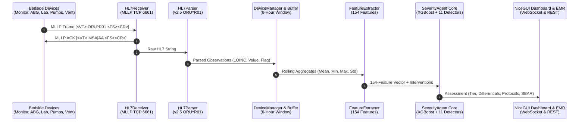

# 🌊 ICU Guard v5.0 — Real-Time Telemetry Data Flow Architecture

This document specifies the complete pipeline architecture from bedside ICU devices to clinical reasoning execution and clinician handoff alerts.

---

## 1. End-to-End Pipeline Diagram

---

## 2. Telemetry Ingestion Timing & Rates

| Device Modality | Protocol | Standard ICU Cadence | Simulator Cadence | Latency Budget |
|---|---|---|---|---|
| **Bedside Monitor** | HL7 ORU^R01 | Every 30 - 60 sec | 30 sec (or dilated) | < 25 ms |
| **ABG Analyzer** | ASTM / POCT1-A / HL7 | Every 1 - 2 hours or PRN | On-demand / 1 hour | < 50 ms |
| **Central Lab (LIS)** | HL7 ORU^R01 / FHIR | Every 4 - 6 hours | On-demand / 4 hours| < 80 ms |
| **Smart Infusion Pumps**| IHE PCD-01 / HL7 | Continuous titration (5m) | Every 5 min | < 30 ms |
| **Mechanical Ventilator**| HL7 / Medibus | Continuous breath (5m) | Every 5 min | < 30 ms |

---

## 3. Detailed Data Transformation Stages

### Stage 1: MLLP Framing & Handshake (`receiver.py`)
- Sockets receive TCP byte streams framed with RFC MLLP tokens (`\x0b` start block, `\x1c\x0d` end block).
- Acknowledgement (`ACK`) with matching `MSH-10` message control ID is generated and returned immediately to avoid device timeouts.

### Stage 2: Segment Parsing & LOINC Normalization (`parser.py`)
- Unpacks `MSH`, `PID`, `OBR`, and `OBX` segments.
- Extracts `OBX-3` identifiers (`LOINC^Name^LN`), parses float values, units, and clinical abnormal flags (`LL`, `L`, `N`, `H`, `HH`).

### Stage 3: Longitudinal Buffering & 6-Hour Sliding Window (`buffer.py`)
- Stores each observation tagged with `datetime`.
- Enforces an active 6-hour sliding window (`cutoff = now - 6h`), continuously purging expired measurements.
- Calculates streaming statistics: `mean`, `min`, `max`, `std`, and count for all vitals and laboratory analytes.

### Stage 4: 154-Feature Engineering (`feature_extractor.py`)
- Maps buffered time-series to the exact 154 features:
  - 32 Vital features
  - 80 Lab features + missingness indicators
  - 10 Derived physiological indices (`shock_index`, `pulse_pressure`, `bun_creatinine_ratio`, `urine_rate`)
  - 5 Chronic comorbidities
  - Active intervention flags (`vasopressor_6h`, `ventilation_6h`)

### Stage 5: Multi-Modal Severity Reasoning (`agent.py`)
- **XGBoost Triad**: Infers risk probabilities for Mortality, Deterioration, and Severe state.
- **11 Evidence-Based Detectors**: Graded multi-organ injury (Cardiovascular, Renal, Respiratory, Coagulation, etc.).
- **16 Syndrome Pattern Evaluators**: Matches clinical patterns (Septic Shock, Severe ARDS, AKI, Overt DIC).
- **Non-Downgrading Arbitration**: Selects authoritative patient tier (`LOW`, `MEDIUM`, `HIGH`, `CRITICAL`).

### Stage 6: Clinician Notification & EMR Export (`integration.py`)
- Pushes assessment payloads to the NiceGUI real-time dashboard via WebSocket events.
- Emits standardized clinical reports and SBAR communication packets.

---

## 4. Error Handling & Fault Tolerance

1. **Network Disconnection / Port Unavailability**:
   - Device simulators log retry notices and do not crash.
   - Integration bridge continues serving buffered data without throwing fatal exceptions.
2. **Missing Observations**:
   - `_missing` flags in the feature extractor are automatically set to `1` when analytes have not been drawn.
   - Detectors utilize safe fallbacks and bounded imputation.
3. **Data Out of Range (Out-of-Distribution / Sensor Artifacts)**:
   - Clamping logic prevents physically impossible values (e.g. negative heart rate or pH > 8.0).
   - Clinical validator flags sensor disconnection artifacts.
